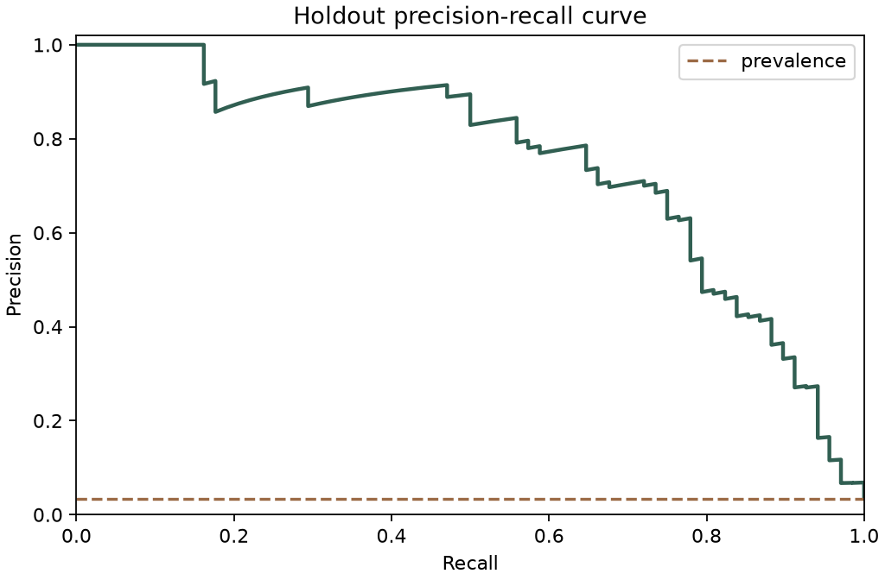
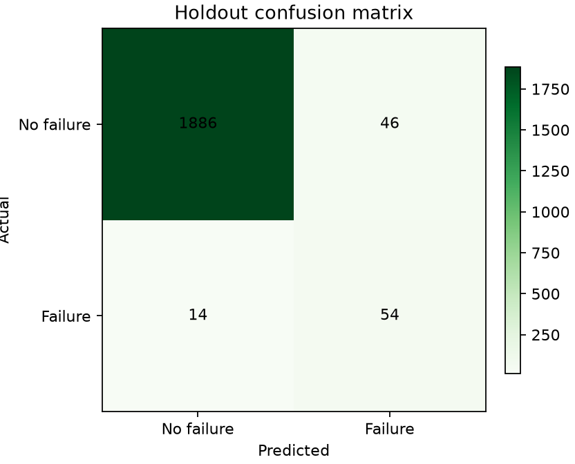

# Machine Risk Monitor: Technical Report

## Summary

Machine Risk Monitor is a local application that estimates the probability of machine failure from
six current operating measurements. It combines a reproducible classification pipeline with a
FastAPI service, browser interface, batch scoring, and local SQLite history. The final random forest
achieved 0.7466 average precision and 0.9690 ROC-AUC on a sequestered 2,000-row holdout. At the
development-selected operating cutoff, recall was 0.7941 and precision was 0.5400.

## Background

Predictive maintenance uses observed operating conditions to identify equipment that may require
attention before a failure. Public industrial failure data are difficult to obtain, so this study
uses the AI4I 2020 Predictive Maintenance Dataset. UCI describes it as a synthetic dataset intended
to reflect industrial predictive-maintenance data; it contains 10,000 observations, six model
features, and no missing values [1]. Matzka introduced the dataset alongside work on explainable AI
for predictive-maintenance applications [2].

The dataset is strongly imbalanced: 339 of 10,000 records (3.39%) are labeled as failures. Accuracy
alone would therefore be misleading—a classifier predicting no failures would already be 96.61%
accurate. Precision-recall analysis is more informative when positive cases are rare because it
shows how the rate of detected failures trades against false alarms [4].

## Problem definition

The application answers a narrow screening question: given product type, air temperature, process
temperature, rotational speed, torque, and tool wear, how much evidence does the fitted model assign
to the machine-failure class?

The result is not a diagnosis or an automatic maintenance command. The intended workflow is:

1. an operator enters one reading or uploads a batch;
2. the application validates each value against the published data domain;
3. the model returns a probability and risk band;
4. qualified personnel decide whether inspection is warranted.

Identifiers are excluded because they have no operational meaning. The five published failure-mode
columns are also excluded because they directly determine the target and would leak the answer into
the model.

## Proposed solution

### Data and validation

The retrieval command downloads the official UCI archive, verifies the expected SHA-256 digest,
and checks column order, row count, null values, categories, and binary targets. The six allowed
features form an explicit contract shared by training and inference.

### Modeling method

The data are split deterministically and with class stratification into 8,000 development rows and
2,000 holdout rows. Stratification preserves approximately the same class proportion in each split
and fold [5]. The holdout identifiers are hashed into the artifact so evaluation can detect a changed
partition.

Three scikit-learn pipelines are compared with five-fold stratified cross-validation:

- a prior-probability dummy classifier;
- class-weighted logistic regression with standardized numeric features;
- a 300-tree random forest with balanced subsampling and a minimum leaf size of two.

Categorical product type is one-hot encoded inside each pipeline. The random forest is an ensemble
of randomized tree predictors, following the general method described by Breiman [3]. Candidate
selection uses mean cross-validated average precision rather than accuracy.

After model selection, five-fold out-of-fold development probabilities are used to choose the
operating threshold that maximizes F2. F2 gives recall more weight than precision, which matches a
screening use case where missing a potential failure is treated as more costly than requesting an
extra inspection. The threshold is fixed before the holdout is scored.

### Application design

```text
official CSV -> validation -> EDA -> cross-validation -> model artifact
                                                        |
browser / CSV -> FastAPI -> Pydantic validation -> predictor -> SQLite history
```

The saved artifact contains the fitted preprocessing/model pipeline, feature contract, source
checksum, partition identity, and validated threshold. FastAPI exposes single and batch prediction
routes. SQLAlchemy stores inputs, probability, risk band, model name, threshold status, source, and
time in SQLite. The HTML interface calls the same application services as the API.

The Docker image packages the evaluated artifact and application, runs as an unprivileged user, and
checks `/health`. This follows the standard Dockerfile model of declaring a base, copying the build
context, installing dependencies, and defining a runtime command [7].

## Results

### Development comparison

| Candidate | Mean average precision | Mean ROC-AUC | Mean precision | Mean recall | Mean F1 |
| --- | ---: | ---: | ---: | ---: | ---: |
| Dummy | 0.0339 | 0.5000 | 0.0000 | 0.0000 | 0.0000 |
| Logistic regression | 0.4414 | 0.8992 | 0.1391 | 0.8193 | 0.2377 |
| Random forest | **0.7390** | **0.9708** | **0.7902** | 0.5389 | **0.6364** |

The random forest was selected because it had the highest mean cross-validated average precision.
The logistic model recovered more failures at its default cutoff but generated substantially more
false positives. Threshold selection was handled separately from model selection.

### Threshold and holdout

The out-of-fold development optimum was an F2 of 0.7503 at a probability cutoff of 0.274592. The
fixed model and cutoff then produced:

| Metric | Holdout result |
| --- | ---: |
| Rows / failures | 2,000 / 68 |
| Failure prevalence | 0.0340 |
| Average precision | **0.7466** |
| ROC-AUC | **0.9690** |
| Precision | 0.5400 |
| Recall | 0.7941 |
| F1 | 0.6429 |
| F2 | 0.7258 |

The confusion matrix contains 1,886 true negatives, 46 false positives, 14 false negatives, and 54
true positives. The selected model's holdout average precision is substantially above the dummy
baseline of 0.0340. The full machine-readable result is in
`artifacts/evaluation/evaluation_report.json`.





## Discussion

The result shows that the six operating features contain enough structure to rank failures well in
this synthetic dataset. The 0.9690 ROC-AUC indicates strong ranking across both classes, while the
0.7466 average precision gives a more demanding view under the 3.4% failure prevalence. At the
chosen threshold, the model detects 54 of 68 failures but sends 46 non-failures for inspection.

That tradeoff is intentional, not universally optimal. A real maintenance team should choose a
cutoff from the relative cost of missed failures, inspections, downtime, and parts. It should also
test probability calibration, stability over time, and performance by machine population before
operational use. The current threshold must not be transferred to equipment whose sensors or
operating ranges differ from the source data.

The application makes several engineering decisions inspectable: source checksum validation,
leakage-column exclusion, deterministic splitting, cross-validated selection, a sequestered
holdout, versioned artifacts, typed API boundaries, persisted prediction records, automated tests,
and a reproducible container. These controls support validity and transparency, consistent with the
NIST AI RMF emphasis on managing AI risks throughout design, evaluation, and use [6].

## Limitations and responsible use

1. **Synthetic evidence.** The dataset models plausible relationships but does not reproduce the
   full noise, drift, interventions, sensor faults, and maintenance practices of a real plant.
2. **No causal diagnosis.** A high probability does not identify a failed component or prove why a
   machine will fail.
3. **Residual misses.** Fourteen of 68 holdout failures were below the selected cutoff. Automated
   shutdown or safety decisions would therefore be inappropriate.
4. **False alarms.** Forty-six holdout non-failures were flagged, so indiscriminate use could create
   unnecessary inspections.
5. **Limited inputs.** There are no vibration signals, maintenance logs, temporal histories,
   environmental context, or technician observations.
6. **No production monitoring.** The local application has no drift detection, authentication,
   audit administration, or real-time sensor connection.
7. **Human oversight.** Results should be reviewed alongside inspection and domain knowledge. Model
   output must remain advisory.

## Conclusion

Machine Risk Monitor demonstrates an end-to-end, locally reproducible classification workflow for
an imbalanced predictive-maintenance problem. It prevents direct target leakage, compares a dummy
baseline and two learned candidates, selects its threshold without using the holdout, and exposes
the evaluated model through tested single and batch interfaces. The holdout result is promising for
the benchmark but is not evidence of production readiness. A defensible next step would be a
time-indexed evaluation on real equipment data followed by calibration, drift monitoring, and a
maintenance-cost study.

## References

1. UCI Machine Learning Repository. “AI4I 2020 Predictive Maintenance Dataset.” 2020.
   [doi:10.24432/C5HS5C](https://doi.org/10.24432/C5HS5C).
2. S. Matzka. “Explainable Artificial Intelligence for Predictive Maintenance Applications.”
   *2020 Third International Conference on Artificial Intelligence for Industries*, pp. 69–74.
   [doi:10.1109/AI4I49448.2020.00023](https://doi.org/10.1109/AI4I49448.2020.00023).
3. L. Breiman. “Random Forests.” *Machine Learning*, 45, pp. 5–32, 2001.
   [doi:10.1023/A:1010933404324](https://doi.org/10.1023/A:1010933404324).
4. scikit-learn developers. “Precision-Recall.”
   [scikit-learn documentation](https://scikit-learn.org/stable/auto_examples/model_selection/plot_precision_recall.html).
5. scikit-learn developers. “StratifiedKFold.”
   [scikit-learn API reference](https://scikit-learn.org/stable/modules/generated/sklearn.model_selection.StratifiedKFold.html).
6. E. Tabassi. *Artificial Intelligence Risk Management Framework (AI RMF 1.0)*. NIST AI 100-1,
   2023. [doi:10.6028/NIST.AI.100-1](https://doi.org/10.6028/NIST.AI.100-1).
7. Docker. “Dockerfile overview.”
   [Docker documentation](https://docs.docker.com/build/concepts/dockerfile/).
